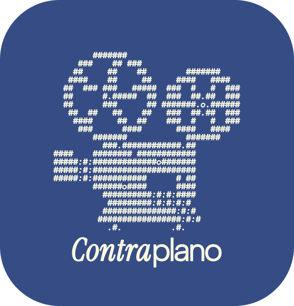

# Contraplano

> Um universo, diversos conteúdos.

**Contraplano** é um site individual de cinema: um espaço para registrar os filmes que assisto, escrever resenhas e acompanhar métricas sobre o meu repertório. 
Projeto Indiividual do 1º semestre de Análise e Desenvolvimento de Sistemas (ADS) na SPTECH.

---

## Sobre o projeto

Quero ter dados do que assisto, aumentar meu repertório, conhecer novas culturas e sair da zona de conforto. O Contraplano reúne isso em um só lugar:

- uma **página inicial** com as resenhas, no estilo de uma newsletter;
- um **perfil** com dashboard de métricas;
- um **cadastro de filmes** feito por formulário, para registrar nome, ano, diretor, país e outros dados.

Os filmes são inseridos manualmente (sem importar do Letterboxd), para eu ter controle sobre o que alimenta a dashboard.

## Funcionalidades

| Funcionalidade | Status |
|---|---|
| Página inicial (navbar, hero, resenhas, sobre mim) | ✅ Em HTML/CSS |
| Cadastro de usuário com código de ativação | ✅ Funcionando |
| Login | ✅ Funcionando |
| Cadastro de filmes | ✅ Funcionando |
| Dashboard do perfil | 🚧 Em desenvolvimento |

### Dashboard (planejada)

- Filmes assistidos no mês e no ano
- Gráfico de filmes por ano de lançamento (Chart.js)
- Diretor mais visto
- País mais visto
- Gênero mais visto

## Tecnologias

- **HTML** e **CSS** 
- **JavaScript**
- **Node.js** e **Express** (API web-data-viz)
- **MySQL** (banco de dados)
- **Chart.js** (gráficos da dashboard)
- **Figma** (protótipo e identidade visual)

## Identidade visual

| | |
|---|---|
| **Fontes** | Instrument Serif (títulos) e Albert Sans (textos) |
| **Azul** | `#364C84` |
| **Creme** | `#FFFDF5` |
| **Logo** | projetor de cinema antigo em arte ASCII, com "Contra" em itálico e "plano" regular |

## Organização do projeto

O desenvolvimento seguiu um cronograma por semanas:

1. **Documentação e KV** (identidade visual no Figma)
2. **HTML e CSS** (construção das páginas)
3. **API** no login e no cadastro
4. **Dashboard** e apresentação

## Autora

**Julia Carolina Brito dos Santos**
Estudante de ADS na SPTECH · [LinkedIn](https://www.linkedin.com/in/SEU-PERFIL) · [GitHub](https://github.com/caju1911) · [Behance]